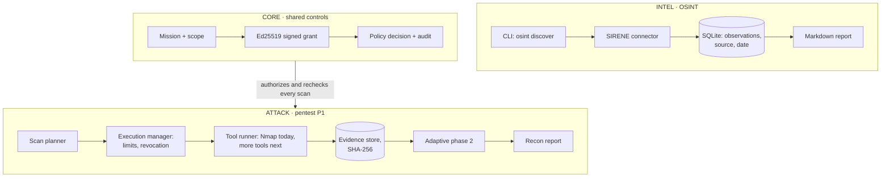

<p align="center">
  
</p>

<h1 align="center">ARGOS</h1>

<p align="center">
  <b>Autonomous cybersecurity missions, with verifiable evidence.</b><br>
  OSINT, offensive and defensive security in one platform, within an explicitly authorized mission.
</p>

<p align="center">
  
  
  
  
  
</p>

<p align="center">
  <a href="docs/presentation/ARGOS-presentation.pdf"><b>Project presentation (PDF, 12 slides)</b></a>
  (<a href="docs/presentation/ARGOS-presentation-fr.pdf">version française</a>) ·
  <a href="#what-works-today">What works today</a> ·
  <a href="#architecture">Architecture</a> ·
  <a href="#getting-started">Getting started</a>
</p>

---

## Why ARGOS

Most small companies have no security team and almost no security budget, while attacks are getting cheaper to run with AI. Only 20% of French SMEs say they are prepared for cyber risk, and 89% of companies with 10 to 49 employees employ no IT specialist (sources on slide 3).

ARGOS answers with one platform covering four areas — **OSINT**, **offensive security**, **defensive security / GRC**, and **continuous validation** — for three users:

| SME | Managed service provider | Security expert |
| --- | --- | --- |
| *"I want to know how to protect myself at the lowest cost."* | *"I want to sell and strengthen my security services."* | *"I want to automate the repetitive work and keep technical control."* |

On the offensive side, ARGOS aims to cover the main fields of a pentest engagement:

| Field | Scope |
| --- | --- |
| **Web and API** | Web applications and APIs: discovery, authentication, access control, injections |
| **Network and infrastructure** | Hosts, exposed services, network segmentation, misconfigurations |
| **Active Directory** | Enumeration, attack paths, Kerberos and delegation weaknesses |
| **AI security** | LLM applications and AI agents: prompt injection, jailbreaks, tool abuse, data leakage |

The product target is **complete mission autonomy**: plan, execute authorized
tools, verify observations, adapt and report without repeated approval of
preauthorized steps. The operator defines the mandate, scope, budgets and stop
conditions; deterministic code enforces them independently of the model.
Core capabilities keep working without an LLM. No agent is connected today.

<p align="center">
  
  
</p>

## What works today

ARGOS is under active development. Each capability below is implemented and covered by tests; the rest is designed and tracked in the [roadmap](#roadmap).

### OSINT — company discovery

- Bounded searches in INSEE's public **SIRENE** database, from a command-line tool.
- **Traceability:** every data point keeps its source and collection date, in SQLite.
- Readable **Markdown reports** stating the scope, the coverage and whether a search was partial.

### ATTACK P1 — authorized pentest engine

The execution framework every offensive tool will run through: ARGOS, not the operator, chooses and runs bounded actions inside a signed mission. **Nmap is the first integrated tool**, for network reconnaissance. Many more will follow for web, infrastructure, Active Directory and AI security testing, each one behind the same mission, allowlist and evidence controls.

Safety is enforced by code, not by prompts:

- **Missions with a signed grant:** a mission has a validity window, explicit target scope and allowed actions. The grant is signed with **Ed25519** and verified before submission, before launch, and about every 250 ms while the scan runs. Revocation or expiry stops the scan.
- **No shell, no free-form commands:** Nmap options come from an allowlist and run as argument arrays, with time, concurrency and output-size limits.
- **Evidence you can verify:** command arguments, timestamps, exit status and raw XML are stored with **SHA-256** hashes. Follow-up steps refuse to run on missing or altered evidence.
- **Adaptive reconnaissance:** TCP discovery of common ports, then service identification on the open ports only, through the same authorization gateway. At most two phases.
- **Honest reports:** open ports are observations, never presented as confirmed vulnerabilities. Suggested investigations are hints, not executable actions.
- **Audit trail** of every policy decision and job event.
- **Persistent requests and results:** plans and job states survive restart;
  terminal state, canonical audit and evidence commit together. Interrupted
  executions become interrupted; pending requests can resume explicitly after
  revalidation. One runtime owns each local database through POSIX locking;
  see [P1 progress](docs/product/EXECUTION_P1.md).

This first increment does no exploitation, credential attacks or intrusive scripts. The engine is a backend library for now: it is not yet exposed through the API or the web interface. Its [known limitations](docs/product/PENTEST_P135_HARDENING.md#security-limitations-not-production-ready) are documented, and it is not production-ready.

### Engineering

- **985 Python tests** validated on Python 3.12 and 3.14 with host isolation
  qualification enabled (912 regular tests and 73 host tests requiring opt-in).
  Owned local HTTP/TLS endpoints and synthetic processes, no client scans;
  repository-wide Ruff and pinned Pyright; GitHub Actions configuration covering backend and frontend.
- **Mission network isolation:** the execution manager defaults to rootless
  Linux workers with a destination/port firewall, cgroup quotas and descendant
  cleanup. Dependencies must be provisioned; no automatic host fallback.
  See the [network report](docs/product/MISSION_NETWORK.md). Real Nmap lab
  qualification remains open.
- **Web foundation:** a FastAPI API (health endpoint) and a React / TypeScript /
  Vite application, with 22 Vitest tests and two Playwright browser scenarios.
- Modular monolith ([ADR 0001](docs/architecture/adr/0001-modular-monolith.md)), dependencies locked with `uv`.

## Architecture



### The agentic core (designed)

A reliable agent for long security missions needs more than a prompt. The [agentic architecture](docs/architecture/AGENTIC_CORE.md) defines ten subsystems — agent loop, planning, context engine, state management, memory, tool runtime, multi-agent orchestration, multi-surface execution, learning engine, safety and evaluation. The document describes a target architecture; current delivery status belongs to the [roadmap](docs/product/ROADMAP.md). [Candidate components](docs/product/REFERENCES.md), including Hermes, remain under evaluation.

<p align="center">
  
  
</p>

## Roadmap

<p align="center">
  
</p>

The [canonical roadmap](docs/product/ROADMAP.md) owns delivery status,
dependencies and the next task. The slide above is an earlier presentation
snapshot, not the active backlog.

The first commercial target is **autonomous external black-box web and API
pentesting**, starting from a URL or domain. The current CLI supports bounded
HTML discovery, controlled HTTP, evidence and a first open-redirect check with
retesting. The `web browse` command runs Chromium through the signed HTTP
runtime, records API observations, and follows links created by JavaScript.
Durable receipts, DOM provenance, redacted reports and explicit recovery are
connected. Signed v4 missions also support `web request` for bounded anonymous
JSON/form requests, explicit methods and writes, with redacted receipts and
recovery that never replays uncertain writes. Browser redirects and sessions
are the next steps. A complete autonomous pentest and
an LLM mission loop remain to be built.

See the [web delivery plan](docs/product/WEB_PENTEST_PLAN.md),
[capability catalogue](docs/product/WEB_CAPABILITIES.md) and
[current interaction work](docs/product/WEB_INTERACTIONS.md).
Evaluation uses benchmarks and client comparisons; a passing software test
suite does not demonstrate senior-level vulnerability discovery.

## The presentation

The [full deck (PDF)](docs/presentation/ARGOS-presentation.pdf) ([version française](docs/presentation/ARGOS-presentation-fr.pdf)) explains the vision, the agentic design, the market and the business model.

<details>
<summary><b>Browse all 12 slides</b></summary>
<br>

| | |
| --- | --- |
|  |  |
|  |  |
|  |  |
|  |  |
|  |  |
|  |  |

The interface on slide 11 is a design mock-up (in French); the web application in this repository does not show these screens yet.

</details>

## Tech stack

| Area | Tools |
| --- | --- |
| Backend | Python 3.12, FastAPI, Pydantic, httpx, SQLite, `cryptography` (Ed25519) |
| Security tooling | Nmap (allowlisted options, XML parsing) |
| Frontend | React, TypeScript, Vite, Vitest, Playwright |
| Quality | pytest, Ruff, Pyright, ESLint, GitHub Actions, locked dependencies |

## Getting started

Requirements: Python 3.12 or later and [uv](https://docs.astral.sh/uv/).
The local interpreter is pinned in `.python-version`; CI tests 3.12 and 3.14.
Node.js 24.18.0 is used in CI and is required locally for the frontend checks
and the Python type checker.

```bash
uv sync --locked --group dev
uv run --locked ruff check .
uv run --locked ruff format --check .
uv run --locked pyright
uv run --locked pytest -q
```

After moving or renaming an existing checkout, rebuild its local environment
with `uv sync --locked --group dev --reinstall` to refresh editable paths and
script launchers. Do not commit the environment. The [P0 validation record](docs/product/FIABILISATION_P0.md)
lists executed checks and their limits.

### OSINT discovery

Create a local `.env` from `.env.example` and fill in `INSEE_API_KEY` privately (never commit it; an existing environment variable takes priority over the file).

```bash
uv run python -m argos osint discover --help
```

`discover` takes an activity, a location and an explicit SIRENE query; `--name` sets a readable folder name and `--max-pages` bounds the collection.

Each run stores observations in `.argos/osint/argos.sqlite3` and writes a numbered report under `outputs/sirene/RESEARCH_NAME/rapport-001.md`. Reports list the scope, coverage, source, query and establishments; partial searches are marked as non-exhaustive. Both folders are excluded from Git.

Export a saved search again, without an API call or key:

```bash
uv run python -m argos osint report --search-id SEARCH_UUID --name garages-marseille
```

### Web application

```bash
# Terminal 1: API on http://localhost:8000 (GET /api/v1/health)
bash scripts/dev-api.sh

# Terminal 2: web app on http://localhost:8013, proxies /api
bash argos/frontend/start-local.sh
```

From `argos/frontend`, install with `npm ci`, run `npm run check`, then install
the matching browser with `npx playwright install chromium` before
`npm run test:e2e`. See the [frontend instructions](argos/frontend/README.md).

## Repository layout

```text
argos/
  backend/
    core/          missions, scope, policy, signed approvals, audit
    attack/pentest planner, execution manager, Nmap runner and parser, evidence, reports
    intel/osint    SIRENE connector, discovery, storage, reports
    api/           FastAPI application
  frontend/        React / TypeScript / Vite application
docs/
  product/         vision, scope, roadmap, pentest increments
  architecture/    architecture, agentic core, ADRs
  presentation/    project deck (PDF) and slide images
tests/             pytest suite
```

## Documentation

Start with the [documentation index](docs/README.md). It distinguishes current
behavior, delivery plans, technical contracts and historical material.

- Development: [repository instructions](AGENTS.md).
- Product: [roadmap and current status](docs/product/ROADMAP.md), [scope](docs/product/SCOPE.md), [web delivery plan](docs/product/WEB_PENTEST_PLAN.md).
- Web capabilities: [coverage catalogue](docs/product/WEB_CAPABILITIES.md), [current interaction work](docs/product/WEB_INTERACTIONS.md).
- Architecture: [implemented system](docs/architecture/ARCHITECTURE.md), [agent design](docs/architecture/AGENTIC_CORE.md).

## Responsible use

ARGOS only scans targets covered by an explicit, signed and unexpired mission. Use it on systems you own or are authorized in writing to test.

## Author

**Jérémie Nagi** — Master of Science student at Epitech Marseille, working on AI and cybersecurity.
[GitHub](https://github.com/JN13012)
